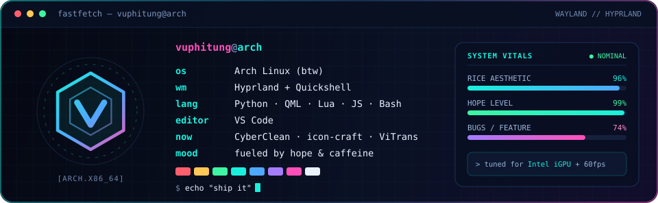
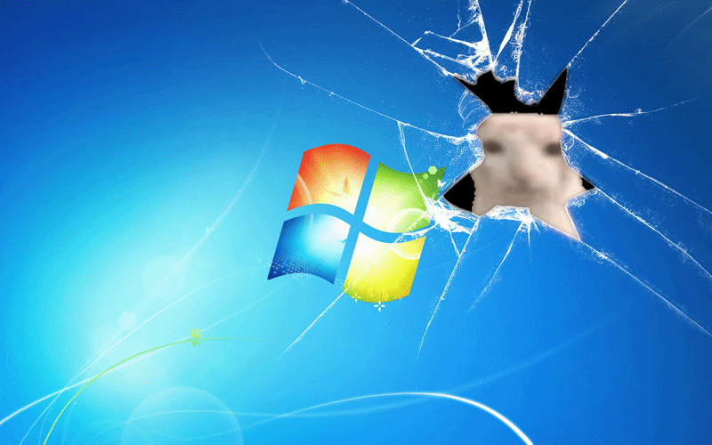

  

### `~/about`

Viết bug nhiều hơn code chạy được, nhưng vẫn cố build mấy cái tool cho đẹp.
Đang phát triển [**CyberClean**](https://github.com/vuphitung/CyberClean), [**icon-craft**](https://github.com/vuphitung/icon-craft), [**ViTrans**](https://github.com/vuphitung/vitrans) và rice Arch Linux với [**CyberDotfiles**](https://github.com/vuphitung/CyberDotfiles) — chạy hoàn toàn bằng hy vọng.

  

### `~/stack`

  

### `~/projects`

<!-- PROJECTS:START -->

  
  
  
  

<!-- PROJECTS:END -->

### `~/activity`

  

### `~/contact`

  
  

  

  

