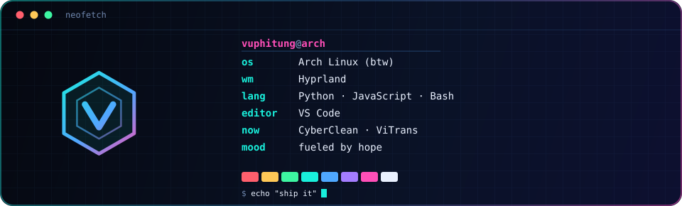
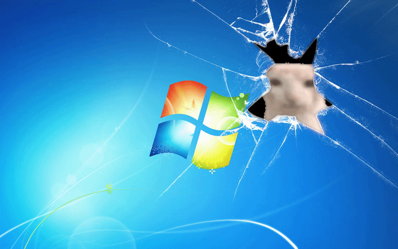

  

### `~/about`

Viết bug nhiều hơn code chạy được, nhưng vẫn cố build mấy cái tool cho đẹp.
Đang làm [CyberClean](https://github.com/vuphitung/CyberClean), [ViTrans](https://github.com/vuphitung/vitrans) và rice Arch Linux với Hyprland, chạy bằng hy vọng.

  

### `~/stack`

  

### `~/projects`

  
  
  
  

### `~/activity`

### `~/contact`

  

